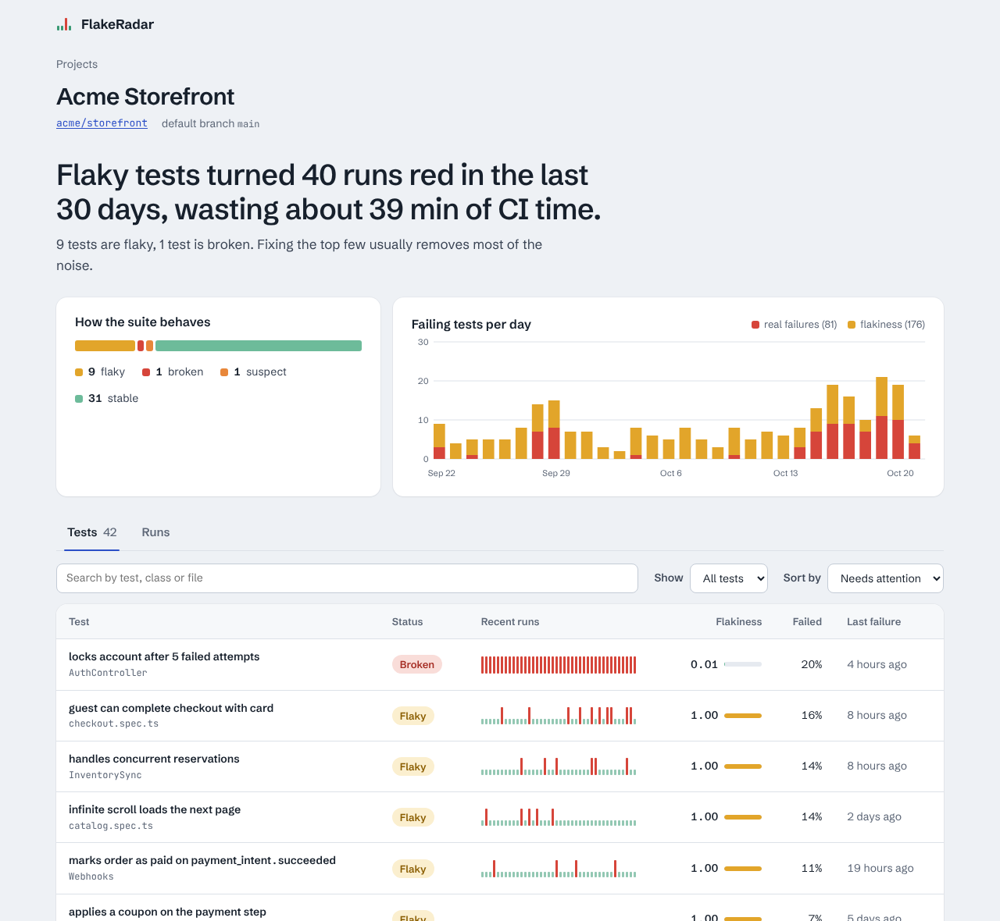
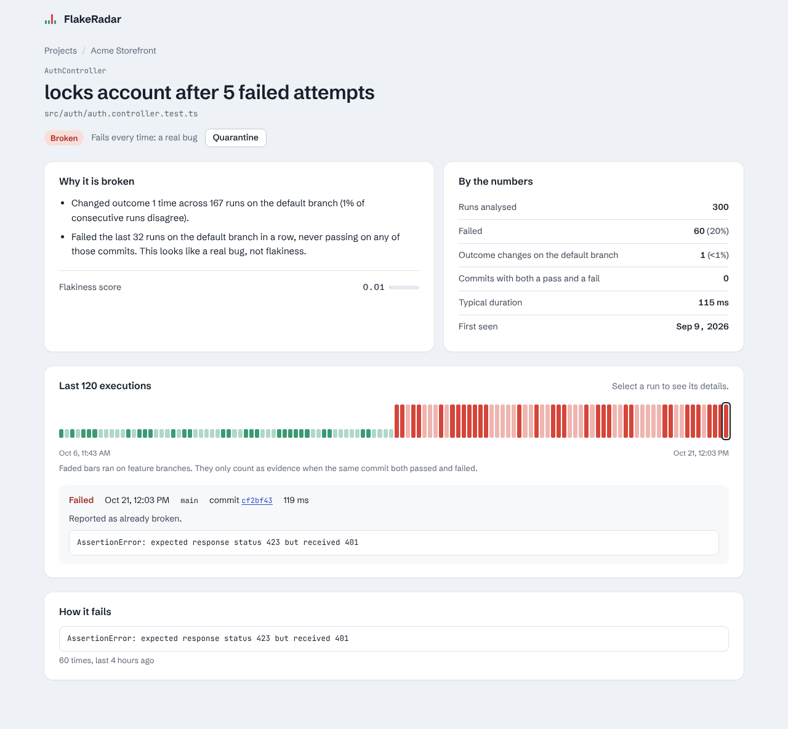
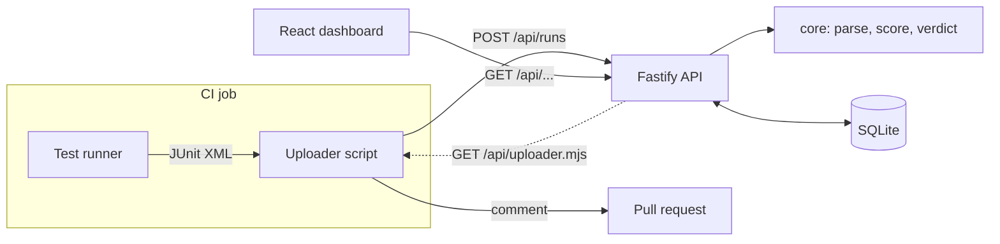

# FlakeRadar

**Find the flaky tests in your CI, and stop letting them block pull requests.**

**[Live demo](https://vojvodixdev.github.io/flakeradar/)** with sample data from two fictional projects. No sign-up, nothing to install.

FlakeRadar is a self-hosted service for your CI (GitHub Actions, GitLab CI or
anything else). It collects the JUnit reports your test runner already produces, scores every test for flakiness,
and comments on each pull request with which failures are real regressions and
which are known noise that is safe to re-run.



## The problem

Every team with a big enough test suite has tests that fail at random: a race
condition, a timeout, a dependency on the clock. Engineers learn to hit
"re-run" without reading the failure, which means that one day they re-run
past a real bug. Meanwhile nobody knows *which* tests are flaky or how much CI
time they burn.

FlakeRadar answers three questions:

1. **Is this failure in my pull request my fault?** The PR comment separates
   likely regressions from known flakiness.
2. **Which tests should we fix first?** Every test gets a flakiness score with
   a plain-language explanation of why.
3. **What does flakiness cost us?** The dashboard shows how many runs went red
   only because of flaky tests, and how much CI time that wasted.

## How it decides what is flaky

"Fails sometimes" is not the same as "flaky". A test that started failing on
Tuesday and kept failing is a real bug. FlakeRadar looks for two kinds of
evidence and combines them:

- **Same code, different outcome.** If a test passed and failed on the same
  commit (for example a CI retry went green), it is non-deterministic by
  definition. This is the strongest signal.
- **Flip rate on the default branch.** How often consecutive runs disagree,
  measured with the lower bound of a Wilson confidence interval so that two
  flips in three runs do not outrank twenty flips in a hundred. Flips on
  feature branches are ignored, because there the code is *supposed* to change
  between pushes.

A test that fails on every recent run of the default branch, never passing on
any of those commits, is labelled **broken** instead: that is a bug to fix, not
flakiness to tolerate.

Full details, formulas and worked examples are in
[docs/how-it-works.md](docs/how-it-works.md).



## What a pull request comment looks like

> ### FlakeRadar: 2 of 412 tests failed
>
> **1 failure needs attention.** The other failure is known flakiness and can be ignored.
>
> | | Test | Verdict | Flakiness |
> |---|---|---|---|
> | 🔴 | `CartService` › merges duplicate items | Likely regression | 0.00 |
> | 🟡 | `checkout.spec.ts` › guest can complete checkout with card | Known flaky | 1.00 |
>
> <sub>412 tests · 3 skipped · 2 min 41 s · Open dashboard</sub>

The comment is updated on every push instead of adding new ones, and the same
summary is written to the job's summary page.

## Try it locally

You need Node.js 20.19 or newer.

```bash
npm install
npm run seed    # creates two demo projects with ~6 weeks of realistic history
npm run dev     # API on :3000, dashboard on http://localhost:5173
```

The seed script does not insert rows directly. It generates JUnit XML for each
simulated CI run (including Playwright-style retries and workflow re-runs) and
pushes it through the same ingestion code real uploads use.

To try an upload by hand, use a token printed by the seed script:

```bash
curl -X POST http://localhost:3000/api/runs \
  -H "Authorization: Bearer frp_..." \
  -H "Content-Type: application/json" \
  -d '{"commitSha":"abc1234","branch":"main","reports":["<testsuite name=\"s\"><testcase classname=\"Demo\" name=\"works\"/></testsuite>"]}'
```

## Use it in your CI

1. Run the server somewhere your CI can reach (see [Running in production](#running-in-production)).
2. Create a project in the dashboard and store its upload token as a CI secret
   named `FLAKERADAR_TOKEN`.
3. Make your test runner write JUnit XML and add a step after the tests.

There is nothing to install: the step downloads a small, dependency-free
uploader script from your own FlakeRadar server
([`apps/server/uploader/flakeradar-upload.mjs`](apps/server/uploader/flakeradar-upload.mjs)),
so the script always matches the server's API version.

**GitHub Actions**

```yaml
permissions:
  contents: read
  pull-requests: write # for the pull request comment

# ...after the step that runs your tests:
      - name: Report results to FlakeRadar
        if: ${{ !cancelled() }}
        run: |
          curl -fsSL "$FLAKERADAR_SERVER_URL/api/uploader.mjs" -o "$RUNNER_TEMP/flakeradar.mjs"
          node "$RUNNER_TEMP/flakeradar.mjs"
        env:
          FLAKERADAR_SERVER_URL: https://flakes.example.com
          FLAKERADAR_TOKEN: ${{ secrets.FLAKERADAR_TOKEN }}
          FLAKERADAR_JUNIT_PATHS: "**/junit*.xml"
          FLAKERADAR_GITHUB_TOKEN: ${{ github.token }}
```

**GitLab CI**

```yaml
flakeradar:
  stage: .post
  when: always
  image: node:22-slim
  script:
    - curl -fsSL "$FLAKERADAR_SERVER_URL/api/uploader.mjs" -o flakeradar.mjs
    - node flakeradar.mjs
  variables:
    FLAKERADAR_SERVER_URL: https://flakes.example.com
    FLAKERADAR_JUNIT_PATHS: "**/junit*.xml"
  # FLAKERADAR_TOKEN comes from Settings › CI/CD › Variables
```

Any other CI works the same way; set `FLAKERADAR_COMMIT` and
`FLAKERADAR_BRANCH` if it is not GitHub Actions or GitLab.
[docs/example-workflow.yml](docs/example-workflow.yml) is a complete GitHub
workflow with the JUnit flags for Jest, Vitest, Playwright, pytest, Go and Maven.

| Variable | Default | Description |
|---|---|---|
| `FLAKERADAR_SERVER_URL` | required | Base URL of your FlakeRadar server |
| `FLAKERADAR_TOKEN` | required | Project upload token |
| `FLAKERADAR_JUNIT_PATHS` | `**/junit*.xml` | Globs, separated by newlines or commas |
| `FLAKERADAR_GITHUB_TOKEN` | none | Enables the pull request comment on GitHub |
| `FLAKERADAR_COMMENT` | `true` | Set to `false` to skip the comment |
| `FLAKERADAR_FAIL_ON_ERROR` | `false` | Fail the job if the upload fails. By default an outage of FlakeRadar never breaks your build |
| `FLAKERADAR_DEFAULT_BRANCH` | detected | Only needed outside GitHub and GitLab |

On GitHub the script also writes `real-failures` and `flaky-failures` to the
step outputs, so a later step can, for example, fail the job only on real
failures.

## Running in production

FlakeRadar is a single Node.js process that serves both the API and the
dashboard, with all data in one SQLite file. Run it however you like:

```bash
# Directly with Node.js
npm ci && npm run build
ADMIN_TOKEN=... PUBLIC_URL=https://flakes.example.com npm start

# Or with Docker (optional)
ADMIN_TOKEN=$(openssl rand -hex 24) PUBLIC_URL=https://flakes.example.com docker compose up -d
```

To give a public demo instance some data, load the demo projects once with
`node apps/server/dist/seed.js` (in Docker:
`docker compose exec flakeradar node apps/server/dist/seed.js`).

| Variable | Default | Description |
|---|---|---|
| `PORT` | `3000` | HTTP port |
| `DATABASE_PATH` | `apps/server/data/flakeradar.db` (`/data/flakeradar.db` in Docker) | SQLite file |
| `PUBLIC_URL` | none | Dashboard URL used for links in PR comments |
| `ADMIN_TOKEN` | none | Required for creating projects, rotating tokens and quarantining tests. Always set it in production |
| `LOG_LEVEL` | `info` | Pino log level |

Reading the dashboard does not require authentication. If your test names are
sensitive, put the server behind your SSO proxy.

## API

| Method | Path | Auth | Description |
|---|---|---|---|
| `POST` | `/api/runs` | Upload token | Ingest one CI run. Returns the summary, per-failure verdicts and the ready-to-post comment |
| `GET` | `/api/projects` | | All projects with status counts |
| `POST` | `/api/projects` | Admin | Create a project. The upload token is returned once |
| `POST` | `/api/projects/:slug/token` | Admin | Rotate the upload token |
| `GET` | `/api/projects/:slug` | | Overview: counts, 30-day trend, time wasted |
| `GET` | `/api/projects/:slug/tests` | | Tests. Query: `status`, `q`, `sort`, `limit` |
| `GET` | `/api/projects/:slug/tests/:id` | | One test with reasons, history and top failure messages |
| `PATCH` | `/api/projects/:slug/tests/:id` | Admin | `{"quarantined": true}` |
| `GET` | `/api/projects/:slug/runs` | | Recent runs |
| `GET` | `/api/uploader.mjs` | | The uploader script for CI jobs |

Response types are defined once in
[`packages/core/src/api.ts`](packages/core/src/api.ts) and shared by the server
and the dashboard, so an API change that breaks the frontend fails to compile.

## Architecture



```
packages/core   Pure TypeScript, no I/O: JUnit parsing, flakiness scoring,
                PR verdicts and comment rendering. Most of the logic and most
                of the tests live here.
apps/server     Fastify API, SQLite storage and migrations, demo seed, and
                the dependency-free uploader script that CI jobs download.
apps/web        React + Vite dashboard.
```

### Decisions worth explaining

- **The scoring logic is a pure function.** `analyzeFlakiness(samples)` takes
  a list of executions and returns a verdict. No database, no clock, which
  makes it trivial to test with exact scenarios (see
  [`scoring.test.ts`](packages/core/src/scoring.test.ts)).
- **PR verdicts use the status from *before* the run.** Otherwise a PR that
  breaks a test on three pushes in a row would see its own bug reported as an
  old, known problem.
- **"Same commit" means the merge commit that was tested.** For pull requests
  the uploader sends `GITHUB_SHA`, the merge of the branch into its base. If
  the base branch moved, the code under test changed, even though the PR head
  did not.
- **SQLite instead of Postgres.** One file, no extra service to run, and fast
  enough: ingesting a run is one transaction, and scoring reads at most the
  last 300 executions of each touched test through an index. Moving to
  Postgres later only touches `apps/server`.
- **Ingestion is all-or-nothing.** A run is stored, scored and summarised in a
  single transaction, and uploads are idempotent per `(run id, attempt)`.
- **Upload tokens are hashed.** Only a SHA-256 of each token is stored, so a
  leaked database does not leak working credentials. Tokens have 256 bits of
  entropy, which is why a fast hash is fine here.
- **CI downloads the uploader from the server.** Nothing to install or
  version separately, and the script can never be out of date with the API.
  A test checks that both sides use the same comment marker.
- **The uploader never breaks CI by default.** If FlakeRadar is down, the step
  logs a warning and the build carries on.

## Development

```bash
npm test          # unit tests (core) and API tests (server, in-memory SQLite)
npm run typecheck
npm run build     # core, server and dashboard
npm start         # serves the API and the built dashboard on :3000
npm run build:demo  # static, backend-free demo in apps/web/dist-demo
```

The static demo bundles a snapshot of the seeded demo data, so it can be
hosted on any static site (or opened straight from disk) without a server.
Dates are shifted at load time so the sample data always looks recent. The
`Demo site` workflow builds it and publishes it to GitHub Pages on every
push to `main`.

## Roadmap

- Merge request comments on GitLab (uploads from GitLab already work)
- Per-project thresholds for the scoring
- Slack digest: "the five flakiest tests this week"
- Optional auth for reading the dashboard (OIDC)
- Detect which tests became flaky together, which often points at one shared cause

## License

© 2026 Nikola Vojvodić. All rights reserved. The code is public so it can be read and evaluated as part of my portfolio; it is not open source. See [LICENSE](LICENSE) for what is and isn't allowed.
